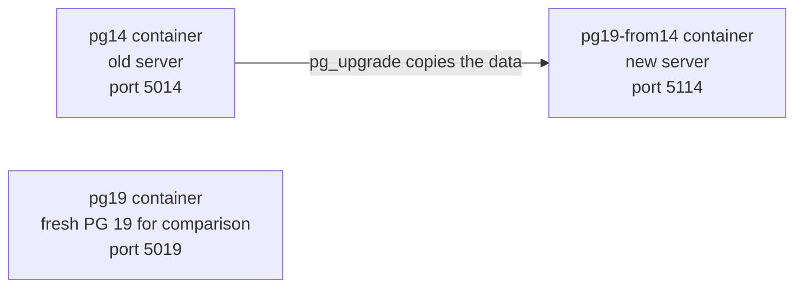
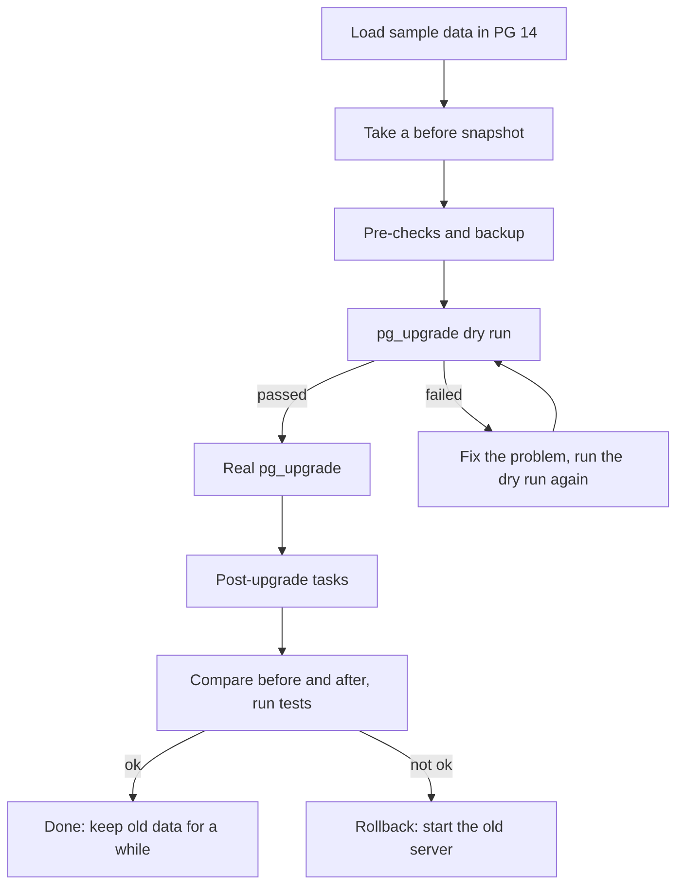

# PostgreSQL Major Version Upgrade — 14 → 19 (Hands-on Lab)

Learn how a PostgreSQL **major version upgrade** works by doing one: PostgreSQL 14 → PostgreSQL 19 using `pg_upgrade` and Podman containers.

- Copy and paste each step, one at a time (about 30 minutes)
- Needs: Ubuntu or WSL2 Ubuntu, internet access, about 2 GB free disk
- Run every command from inside the `pg-upgrade-poc` folder
- Tested end to end: PostgreSQL 14.24 → `postgres:19rc1`, rootless Podman 5.7

---

## Index

| Step | What you do | Stage |
|---|---|---|
| [Step 1](#step-1--install-podman) | Install Podman | Setup |
| [Step 2](#step-2--get-the-lab-files) | Get the lab files | Setup |
| [Step 3](#step-3--start-the-containers) | Start the PG 14 and PG 19 containers | Setup |
| [Step 4](#step-4--load-sample-data-into-pg-14) | Load sample data into PG 14, look at the objects | Prepare |
| [Step 5](#step-5--compare-old-and-new-server-facts) | Compare old and new server facts | Prepare |
| [Step 6](#step-6--take-the-before-snapshot) | Take the before snapshot | Prepare |
| [Step 7](#step-7--pre-upgrade-checks) | Pre-upgrade checks | Prepare |
| [Step 8](#step-8--backup) | Backup | Prepare |
| [Step 9](#step-9--upgrade-dry-run) | Upgrade dry run (changes nothing) | Upgrade |
| [Step 10](#step-10--real-upgrade) | Real upgrade | Upgrade |
| [Step 11](#step-11--post-upgrade-tasks) | Post-upgrade tasks | Upgrade |
| [Step 12](#step-12--validate) | Validate: compare, test, look at the objects | Validate |
| [Step 13](#step-13--rollback-test) | Rollback test | Optional |
| [Step 14](#step-14--optional-see-a-failed-check-on-purpose) | Failed check on purpose | Optional |
| [Step 15](#step-15--clean-up) | Clean up the environment (scripts, folder, containers, images) | Finish |
| [Results from our test run](#results-from-our-test-run) | What we saw | Reference |
| [Questions learners ask](#questions-learners-ask) | Can I upgrade twice? What if the source changes? | Reference |
| [Best practices](#best-practices) | Dos and don'ts | Reference |
| [Troubleshooting](#troubleshooting) | Errors and fixes | Reference |
| [Cheat sheet](#cheat-sheet) | Quick commands | Reference |

- **Shortest path:** Steps 1 → 12 (Steps 13 and 14 are optional)
- **Re-running the lab?** Do [Step 15](#step-15--clean-up) part 15a first (containers and volumes)
- Each step is **one copy-paste block** (or a few, marked a, b, c)

---

## What you will learn

- Why a major upgrade is different from a minor update
- How to prepare: sample data, checks, backup
- How `pg_upgrade` works: dry run first, then the real upgrade
- How to prove nothing was lost (before/after comparison and tests)
- How to roll back, and what a failed check looks like

---

## How it works

- PostgreSQL 14 and 19 store data differently on disk, so PG 19 **cannot open PG 14 data files directly**
- `pg_upgrade` copies the data and converts the internal catalogs to the new format
- We **copy** the data (not link it), so the old server stays untouched and rollback is easy





### Words you will see

| Word | Meaning |
|---|---|
| Major upgrade | 14 → 19 (the first number changes). Minor update: 14.5 → 14.9 |
| `pg_upgrade` | PostgreSQL tool that upgrades a cluster to a new major version |
| Dry run | `pg_upgrade --check`: tests everything, changes nothing |
| Container / volume | Podman runs PostgreSQL in a container; the volume holds the data files |
| Extension | Add-on module (for example `hstore`, `citext`) |
| Collation | Rules for sorting text. A change can break indexes, so we check it |

---

## Step 1 — Install Podman

```bash
sudo apt install podman -y
podman --version
```

Expected output (short):
```text
podman version 5.7.0
```

---

## Step 2 — Get the lab files

```bash
git clone https://github.com/softclement/pg-upgrade-poc.git
cd pg-upgrade-poc
chmod +x scripts/*.sh
ls
```

- No `git`? Run `sudo apt install git -y` first, or use **Code → Download ZIP** on GitHub and unzip it
- Stay in this folder for all the following steps

What is inside:

| File | What it is for |
|---|---|
| `sql/seed.sql` | Sample data: one of almost every PostgreSQL object type |
| `sql/inventory.sql` | Counts all objects and fingerprints the data (for before/after comparison) |
| `sql/precheck.sql` | Checks that the old server can be upgraded |
| `sql/smoke.sql` | Functional tests to run on the new server |
| `scripts/upgrade.sh` | Dry run or real upgrade |
| `scripts/in_upgrader.sh` | Used by `upgrade.sh` inside a temporary container |
| `scripts/post_upgrade.sh` | Tasks after the upgrade |
| `scripts/inventory.sh` | Takes a snapshot using `inventory.sql` |
| `scripts/cleanup.sh` | Removes everything this lab created |

What the sample data creates:

| Category | Objects |
|---|---|
| Cluster | Roles, 3 databases, database-level setting |
| Extensions | pgcrypto, pg_trgm, hstore, citext, btree_gist, uuid-ossp, postgres_fdw |
| Types | Enum, composite, domains, range, ICU collation, multirange |
| Tables | Identity and generated columns, range/list/hash partitions, inheritance, unlogged, exclusion constraint, TOAST |
| Indexes | B-tree, hash, GIN, GiST, BRIN, partial, expression, covering, extended statistics |
| Views | Plain, security barrier, materialized, recursive, `INSTEAD OF` |
| Code | Functions, procedure, operator, aggregate, cast, text search |
| Triggers | Row, statement, constraint, `INSTEAD OF`, rule, event trigger |
| Security | Row-level security, grants, default privileges |
| Integration | Foreign table, publications, large object |

---

## Step 3 — Start the containers

- `podman run` downloads the images automatically
- `pg14` is the old server, `pg19` is a fresh PG 19 we only use for comparison

```bash
podman run -d --name pg19 -e POSTGRES_PASSWORD=postgres -p 5019:5432 docker.io/library/postgres:19rc1
podman run -d --name pg14 -e POSTGRES_PASSWORD=postgres -p 5014:5432 \
  -v pgdata14:/var/lib/postgresql/data docker.io/library/postgres:14
```

Wait until both servers are ready (first start takes a few seconds):

```bash
until podman exec pg14 pg_isready -q -h 127.0.0.1 -U postgres; do sleep 1; done
until podman exec pg19 pg_isready -q -h 127.0.0.1 -U postgres; do sleep 1; done
podman ps --format '{{.Names}}\t{{.Ports}}\t{{.Status}}'
```

---

## Step 4 — Load sample data into PG 14

**4a. Load the data**

```bash
podman exec -i pg14 psql -U postgres -q < sql/seed.sql
```

Expected output (short):
```text
 lo_from_bytea
---------------
        900001
WARNING:  wal_level is insufficient to publish logical changes   (harmless, appears twice)
```

If it stops with an error, reset PG 14 and run 4a again:

```bash
podman rm -f -v pg14 && podman volume rm -f pgdata14
podman run -d --name pg14 -e POSTGRES_PASSWORD=postgres -p 5014:5432 \
  -v pgdata14:/var/lib/postgresql/data docker.io/library/postgres:14
until podman exec pg14 pg_isready -q -h 127.0.0.1 -U postgres; do sleep 1; done
```

**4b. Look at the objects yourself (source)**

```bash
podman exec -it pg14 psql "user=app_owner dbname=appdb options='-c search_path=app'"
```

Try these inside `psql`:

```text
\dt                          -- tables and partitions
\dv                          -- views
\dm                          -- materialized views
\df                          -- functions and procedures
\dT                          -- types
\dx                          -- extensions
\d customers                 -- one table in detail
select count(*) from customers;
\q                           -- quit
```

---

## Step 5 — Compare old and new server facts

- Encoding, collation and checksums must match between old and new for `pg_upgrade`

```bash
for C in pg14 pg19; do
  echo "== $C =="
  podman exec $C psql -U postgres -At -c "select version()" -c "show server_encoding" -c "show data_checksums" \
    -c "select datcollate, datctype from pg_database where datname = 'template1'"
  podman exec $C grep PRETTY_NAME /etc/os-release
done
```

Expected output (short):
```text
== pg14 ==
PostgreSQL 14.24 ...
UTF8
off
en_US.utf8|en_US.utf8
PRETTY_NAME="Debian GNU/Linux 13 (trixie)"
== pg19 ==
PostgreSQL 19rc1 ...
UTF8
on
en_US.utf8|en_US.utf8
PRETTY_NAME="Debian GNU/Linux 13 (trixie)"
```

- Checksums: **off** on 14, **on** by default in new PG 19 → the upgrade script creates the new server with checksums off so they match
- Both are Debian 13 → no sorting-rule (glibc) change

---

## Step 6 — Take the "before" snapshot

```bash
scripts/inventory.sh pg14 pg14
head -12 out/inv_pg14.txt
```

---

## Step 7 — Pre-upgrade checks

```bash
podman exec -i pg14 psql -U postgres -d appdb < sql/precheck.sql
```

- Expected: 0 prepared transactions, no replication slots, no invalid indexes, no `reg*` columns (empty lists)
- Also shows the extension versions (they change after the upgrade)

---

## Step 8 — Backup

- Stop PG 14, copy its data volume to a file, start it again

```bash
podman stop pg14
podman volume export pgdata14 --output backup/pgdata14.tar
podman start pg14
ls -lh backup
```

Expected output (short):
```text
-rw-r--r-- 1 clement clement 111M ... pgdata14.tar
```

---

## Step 9 — Upgrade dry run

- Runs `pg_upgrade --check`: tests whether the upgrade will work
- **Changes nothing**: run it as often as you like

```bash
scripts/upgrade.sh check
```

Expected output (short):
```text
Checking cluster versions                                     ok
Checking data type usage                                      ok
Checking for presence of required libraries                   ok
...
*Clusters are compatible*
```

---

## Step 10 — Real upgrade

- Only run this after Step 9 says `*Clusters are compatible*`

```bash
scripts/upgrade.sh upgrade
```

Expected output (short):
```text
Copying user relation files                                   ok
Checking for extension updates                                notice
...
Upgrade Complete

real    0m2.4s
```

- About 3 seconds for ~111 MB. The notice about extension updates is handled in the next step
- PG 14 is started again automatically; its data was copied, not changed

---

## Step 11 — Post-upgrade tasks

```bash
scripts/post_upgrade.sh
```

What it does:

- Updates extensions in every database (`pg_upgrade` keeps the old extension versions)
- Refreshes planner statistics that were not carried over
- Checks the text-sorting (collation) version

Expected output (short):
```text
extension update: done
vacuumdb: processing database "appdb": Generating minimal optimizer statistics ...
 datname | datcollversion | actual
 appdb   | 2.41           | 2.41      <- same numbers = no REINDEX needed
```

- If `datcollversion` and `actual` differ, run `REINDEX DATABASE appdb;` (not needed here)

---

## Step 12 — Validate

**12a. Compare before and after**

```bash
scripts/inventory.sh pg19-from14 pg19-from14
diff -u out/inv_pg14.txt out/inv_pg19-from14.txt && echo IDENTICAL
```

Expected output (short):
```text
-90 extensions ... | btree_gist 1.6, citext 1.6, ..., pgcrypto 1.3, postgres_fdw 1.1 ...
+90 extensions ... | btree_gist 1.9, citext 1.8, ..., pgcrypto 1.4, postgres_fdw 1.3 ...
```

- Only the extensions line is different (newer versions) = **everything else is identical**: object counts, row counts, data fingerprints, sequence values

**12b. Functional tests on the new server**

```bash
podman exec -i pg19-from14 psql -U postgres -d appdb < sql/smoke.sql
```

- Expected: a new order is created in partition `orders_2026`, only that partition is scanned, the foreign table returns 3 rows, the materialized view refreshes, the large object returns `large object payload`, the user `app_ro` can read 5000 rows, and the protected row survives the `DELETE`

**12c. Check the `public` schema permissions**

```bash
podman exec pg14        psql -U postgres -d appdb    -c '\dn+ public'
podman exec pg19-from14 psql -U postgres -d appdb    -c '\dn+ public'
podman exec pg19        psql -U postgres -d postgres -c '\dn+ public'
```

- Upgraded database keeps the **old** permissions (`=UC` = everyone can create objects in `public`)
- A brand new PG 19 database is stricter (`=U` = usage only)
- Recommended after an upgrade: `REVOKE CREATE ON SCHEMA public FROM PUBLIC;` (after checking your apps)

**12d. Look at the objects yourself (migrated)**

```bash
podman exec -it pg19-from14 psql "user=app_owner dbname=appdb options='-c search_path=app'"
```

- Use the same commands as in Step 4b (`\dt`, `\dv`, `\df`, `\dx`, `select count(*) from customers;`) and compare with the source

**12e. Optional: corruption scan**

```bash
podman exec pg19-from14 psql -U postgres -d appdb -c "CREATE EXTENSION IF NOT EXISTS amcheck"
podman exec pg19-from14 pg_amcheck -U postgres -d appdb --heapallindexed --parent-check
```

- No output = no problems found

---

## Step 13 — Rollback test

- The old data was copied, never changed. Prove it by taking a new snapshot of PG 14

```bash
scripts/inventory.sh pg14 pg14_after
diff out/inv_pg14.txt out/inv_pg14_after.txt && echo "OLD CLUSTER UNCHANGED"
```

- To roll back in real life: stop the new server, start the old one (`podman stop pg19-from14; podman start pg14`)

---

## Step 14 — Optional: see a failed check on purpose

- Some column types block `pg_upgrade`: `regproc` and the other `reg*` types store internal object IDs (OIDs)
- `pg_upgrade` rebuilds the system catalogs and does **not** keep those IDs, so the stored values would point to the wrong objects. The dry run stops you before that can happen
- This step deletes the upgraded server `pg19-from14` (repeat Steps 10 and 11 to get it back)

**14a. Add a problem column to PG 14**

```bash
podman exec pg14 psql -U postgres -d appdb -c "CREATE TABLE app.trap_reg (id int, fn regproc)"
```

**14b. Start from a fresh new server**

```bash
podman rm -f -v pg19-from14; podman volume rm -f pgdata19_from14
```

**14c. Run the dry run, it should FAIL**

```bash
scripts/upgrade.sh check
```

Expected output (short):
```text
Checking data type usage      failed check: Checking for reg* data types in user tables
Your installation contains one of the reg* data types in user tables.
...
Failure, exiting
```

**14d. Fix the problem and run the dry run again, it should pass**

```bash
podman exec pg14 psql -U postgres -d appdb -c "DROP TABLE app.trap_reg"
scripts/upgrade.sh check
```

Expected output (short):
```text
*Clusters are compatible*
```

---

## Step 15 — Clean up

- Use this at the end of the lab, **or before a re-run** to start from a clean environment
- Do the parts in order; each part is separate
- For a re-run you only need **15a**; 15c deletes the scripts too, so you would have to repeat Step 2

**15a. Remove containers and volumes** (`pg14`, `pg19`, `pg19-from14` and their data)

```bash
scripts/cleanup.sh
```

**15b. Remove the downloaded images** (`postgres:14` and `postgres:19rc1`)

- Skip this if you use these images for other labs
- The next run will download them again

```bash
scripts/cleanup.sh --images
```

**15c. Remove the lab folder** (SQL files, scripts, snapshots, backup)

- Deletes the whole `pg-upgrade-poc` folder, including the 111 MB backup file

```bash
cd .. && rm -rf pg-upgrade-poc
```

**15d. Check that nothing is left**

```bash
podman ps -a
podman volume ls
podman images
ls pg-upgrade-poc 2>&1
```

- Expected: no `pg14` / `pg19` / `pg19-from14` containers, no `pgdata14` / `pgdata19_from14` volumes, no `postgres` images, and `ls` says `No such file or directory`

**15e. Optional: uninstall Podman**

```bash
sudo apt remove podman -y
```

---

## Results from our test run

| Check | Result |
|---|---|
| Dry run (`--check`) | ✅ `*Clusters are compatible*` |
| Real upgrade | ✅ `Upgrade Complete` in about 3 seconds (~111 MB) |
| New data directory | `/var/lib/postgresql/19/docker` (versioned path) |
| Extensions | ✅ Updated: btree_gist 1.6→1.9, citext 1.6→1.8, pgcrypto 1.3→1.4, postgres_fdw 1.1→1.3 |
| Before/after snapshot | ✅ Identical, except extension versions |
| Functional tests | ✅ All passed |
| Collation | ✅ No change (both Debian 13) |
| Corruption scan (`amcheck`) | ✅ Nothing found |
| Rollback | ✅ Old server unchanged |
| Failure demo (`reg*` column) | ✅ Dry run failed, then passed after the fix |
| `public` schema | Upgraded DB keeps old permissions; new PG 19 DB is stricter |
| Not tested | Planner statistics transfer details, old `postgresql.conf` settings |

---

## Questions learners ask

**Why does the dry run fail after `CREATE TABLE ... fn regproc`?**

- `regproc` stores the internal ID (OID) of a function. `pg_upgrade` does not keep OIDs, so the value would become wrong in PG 19
- The dry run refuses to continue until you drop or change the column (Step 14)

**Can I upgrade only once?**

- No. `pg_upgrade --check` can run any number of times
- The real upgrade needs a **new, empty** target server. After it has run, that target is used, so for another try create a fresh one (Step 14b) and run again
- In copy mode the old server is never changed, so you can upgrade from it again whenever you like
- Later, you can upgrade the same way again (19 → next version)

**After the upgrade, someone adds a table in the old server. What now?**

- The old and new servers are separate copies. The new table does **not** appear in the new server
- Best: **prevent it**. Stop the application (writes) on the old server before the upgrade, and do not let anyone use it afterwards
- Not live yet: run the upgrade again from the current old server (Step 14b, then Steps 10 and 11). This is the safest and the simplest
- Already live on the new server, only a few objects missing: copy just those objects (not run in our test):

```bash
podman exec pg14 pg_dump -U postgres -d appdb -t app.new_table | podman exec -i pg19-from14 psql -U postgres -d appdb
```

- After copying, check ownership and permissions, and make sure the same data was not changed in both servers
- Large or busy systems that cannot stop: use logical replication or a migration tool with a planned cut-over. Logical replication does **not** copy new tables automatically, so plan for that too

---

## Best practices

**Before**
- Read the release notes of every major version between old and new (15 → 19)
- Update the old server to its latest minor version first
- Rehearse on a copy of production and time it
- Take a backup **and test the restore**
- New server settings must match the old (encoding, collation, checksums)
- Install the same extensions on the new server
- Do not copy the old `postgresql.conf` blindly; some settings are removed in newer versions
- Check that applications and drivers support the new version

**During**
- Always run the dry run (`--check`) first
- Stop the application and the old server cleanly
- Use copy mode when you want an easy rollback (`--link` is faster but rollback is hard)
- Keep the `pg_upgrade` logs

**After**
- Update extensions, refresh statistics, check collation versions
- Compare before and after, run application tests
- Restore backups, monitoring and jobs; take a fresh full backup
- Keep the old data for 1–2 weeks before deleting it
- Review the `public` schema permissions

**Pre-release versions**
- `19rc1` is a release candidate: great for learning, **not for production data**
- Write down the exact image tag you tested

---

## Troubleshooting

| What you see | Why | Fix |
|---|---|---|
| `No such file or directory: scripts/...` or `sql/...` | You are not in the lab folder | `cd pg-upgrade-poc` |
| `Permission denied` when running a script | Script is not executable | `chmod +x scripts/*.sh` |
| `psql: ... socket ... No such file or directory` right after `podman run` | Server is still starting | Wait: `until podman exec pg14 pg_isready -q -h 127.0.0.1 -U postgres; do sleep 1; done` |
| `unrecognized configuration parameter "lc_collate"` on PG 19 | Setting no longer exists | Use `select datcollate from pg_database` |
| `can only create exec sessions on running containers` | Container is stopped | `podman start pg14` (`upgrade.sh` restarts it for you) |
| Dry run fails: `reg* data types in user tables` | Column type that `pg_upgrade` cannot convert | Drop or change the column listed in the message (Step 14) |
| `WARN "/" is not a shared mount` | Podman message | Harmless |
| `wal_level is insufficient to publish logical changes` | Seed creates publications | Harmless |
| Checksum mismatch error | New server has checksums on, old has off | New server must be created with `--no-data-checksums` (the script does this) |
| Seed stops half way | Error in the SQL | Reset PG 14 (Step 4a), run Step 4a again |

---

## Cheat sheet

```bash
# containers
podman ps -a --format '{{.Names}}\t{{.Ports}}\t{{.Status}}'
podman exec -it pg19-from14 psql -U postgres -d appdb

# the upgrade itself
pg_upgrade -b OLDBIN -B NEWBIN -d OLDDATA -D NEWDATA --check    # dry run
pg_upgrade -b OLDBIN -B NEWBIN -d OLDDATA -D NEWDATA            # copy data
pg_upgrade -b OLDBIN -B NEWBIN -d OLDDATA -D NEWDATA --link     # hard links (fast, hard to roll back)

# after the upgrade
vacuumdb --all --analyze-in-stages --missing-stats-only
psql -c "REINDEX DATABASE appdb"        # only if collation version changed
```

| Port | Container | Role |
|---|---|---|
| 5014 | pg14 | Old server |
| 5019 | pg19 | Fresh PG 19 (comparison) |
| 5114 | pg19-from14 | Upgraded server |
